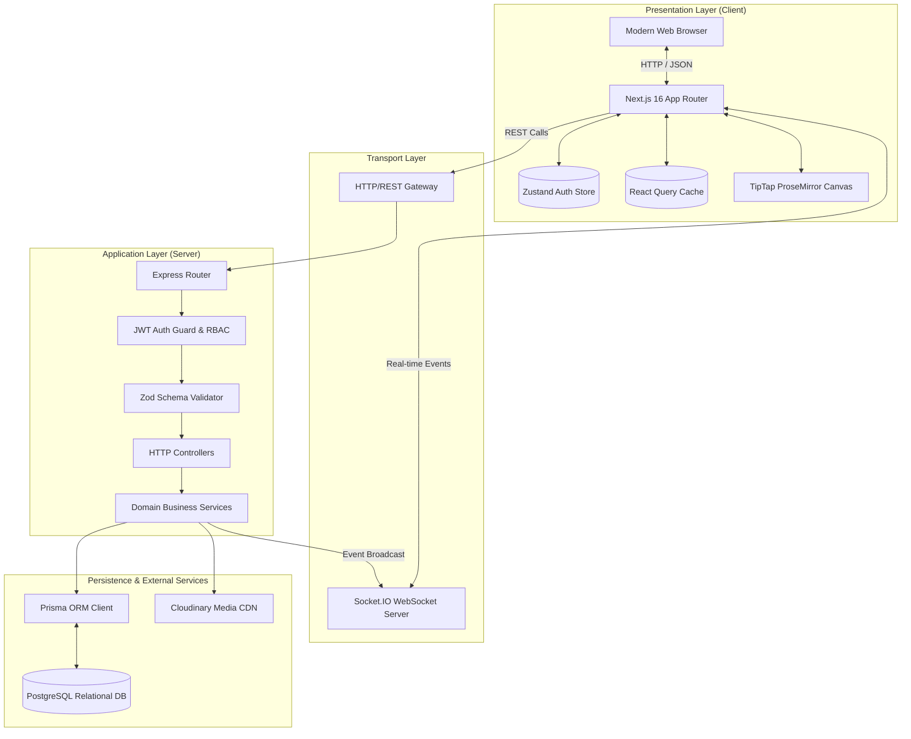
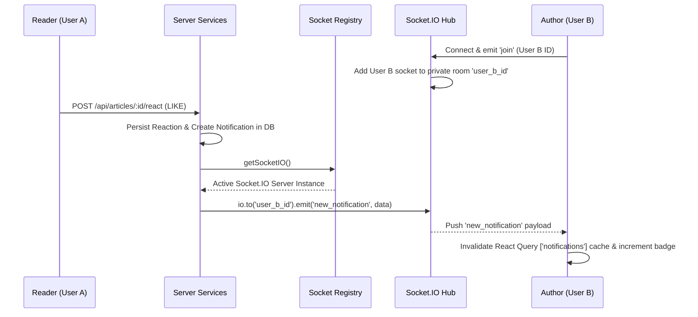

# Architecture & System Design 🏛️

This document outlines the architectural blueprint, design patterns, and engineering decisions implemented in **Siidaa Barruu**.

---

## 1. High-Level Architecture Overview

Siidaa Barruu adopts a **Decoupled Client-Server Monorepo** architecture designed for maintainability, horizontal scalability, and clean boundary separation.

---

## 2. Frontend Architecture (Next.js 16 App Router)

### State Management Separation
The client segregates state into two explicit scopes:
1. **Global Identity State (Zustand)**:
   - Tracks session lifecycle (`user`, `token`, `isInitialized`, `isInitializing`).
   - Syncs session cookies/localStorage safely (`sb_token`, `sb_user`).
   - Implements optimistic persistence and fallback recovery during network blips.
2. **Server-Cache State (TanStack React Query)**:
   - Manages asynchronous remote entities (articles, comments, tags, bookmarks, drafts, notifications).
   - Handles intelligent caching (stale-while-revalidate), pagination, mutation rollbacks, and programmatic invalidations on mutation success.

### Content Editing Engine
- Powered by **TipTap**, a headless ProseMirror framework that decouples the editor state from DOM representation.
- Provides native support for markdown shortcuts, typography extensions, image embeds, code fences, and sanitized HTML generation.

---

## 3. Backend Architecture (Express 5 & Domain Services)

The server follows the **Layered MVC / Service-Repository** architectural pattern:

### Routing Layer (`server/src/routes/`)
Maps HTTP methods and URLs to controller actions. Routes define route-specific middleware chains (e.g., authentication, rate limiting, and multipart file upload handling).

### Middleware Pipeline (`server/src/middleware/`)
1. **Security Headers**: Injects `nosniff`, `X-Frame-Options: DENY`, `Referrer-Policy`, and restrictive `Permissions-Policy`.
2. **CORS Control**: Dynamic multi-origin verification against `CLIENT_URL`.
3. **Authentication**: `authenticate` verifies stateless JWT Bearer tokens; `optionalAuth` extracts identity when present without enforcing login; `requireAdmin` enforces role-based access control.

### Controller Layer (`server/src/controllers/`)
Orchestrates incoming HTTP requests:
- Unpacks request params, query strings, and body data.
- Invokes domain service methods.
- Maps domain responses and exceptions to standard HTTP status codes (`200 OK`, `201 Created`, `400 Bad Request`, `401 Unauthorized`, `403 Forbidden`, `404 Not Found`, `500 Internal Error`).

### Service Layer (`server/src/services/`)
Encapsulates all domain business logic:
- Slug generation with collision resolution loops (`title-1`, `title-2`).
- Reading time calculation based on Afaan Oromo text cadence (100 WPM).
- Notification creation with automatic suppression of self-actions (`actorId === userId`).
- Atomic transactions for bookmarks, reactions, and follows.

---

## 4. Real-Time WebSocket Notification Architecture

Real-time streaming is decoupled from the main server lifecycle via a singleton registry pattern:

---

## 5. Security & Isolation Model

| Dimension | Implementation |
| :--- | :--- |
| **Authentication** | Cryptographically signed JSON Web Tokens (JWT) with configurable expiry. |
| **Password Storage** | Salted SHA-512 with Bcrypt (`rounds: 10`). Plaintext is never stored or logged. |
| **Input Validation** | Strict Zod schema parsing; unrecognized properties are pruned; types are enforced before hitting services. |
| **Circular Dependency Prevention**| Decoupled Socket.IO instance provider in `lib/socket.ts` eliminates circular imports between HTTP server and domain services. |
| **Secrets Management** | Zero credentials in source code. `.env` files are git-ignored and validated on server boot. |
