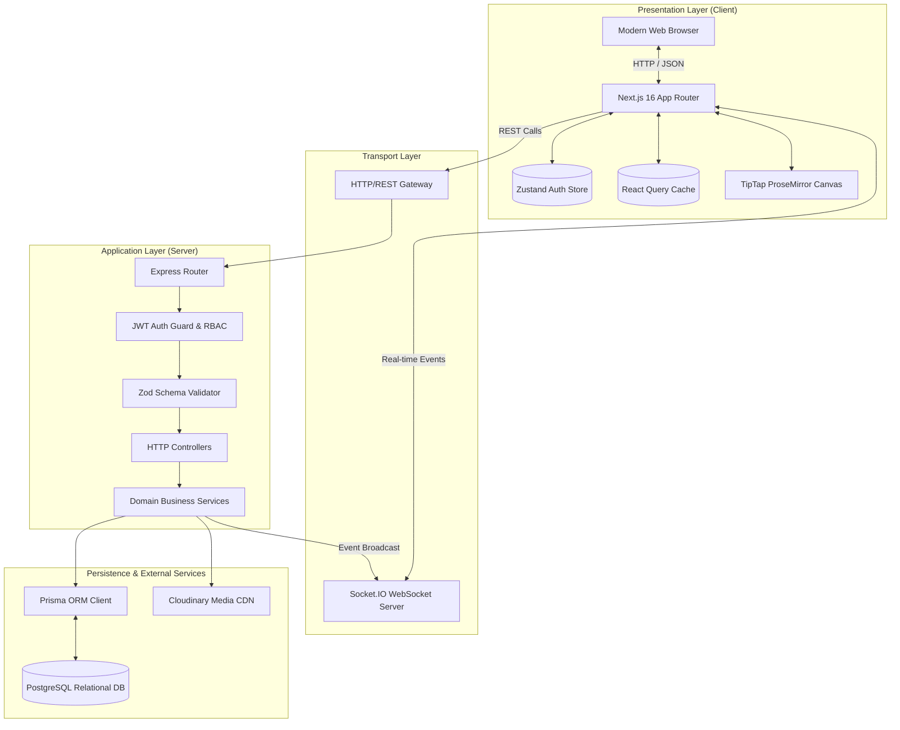
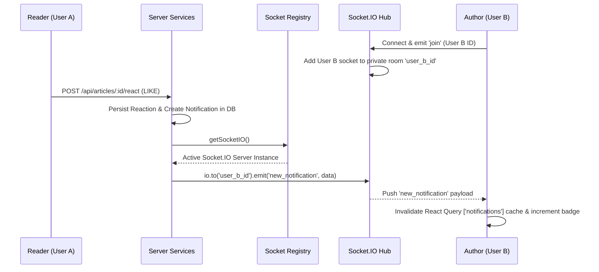

# Architecture & System Design 🏛️

This document outlines the architectural blueprint, design patterns, and engineering decisions implemented in **Siidaa Barruu**.

---

## 1. High-Level Architecture Overview

Siidaa Barruu adopts a **Decoupled Client-Server Monorepo** architecture designed for maintainability, horizontal scalability, and clean boundary separation.



---

## 2. Frontend Architecture (Next.js 16 App Router)

### State Management Separation
The client segregates state into two explicit scopes:
1. **Global Identity State (Zustand)**:
   - Tracks session lifecycle (`user`, `token`, `isInitialized`, `isInitializing`).
   - Syncs session cookies/localStorage safely (`sb_token`, `sb_user`).
   - Implements optimistic persistence and fallback recovery during network blips.
2. **Server-Cache State (TanStack React Query)**:
   - Manages asynchronous remote entities (articles, comments, tags, bookmarks, drafts, notifications).
   - Handles intelligent caching (stale-while-revalidate), pagination, mutation rollbacks, and programmatic invalidations on mutation success.

### Content Editing Engine
- Powered by **TipTap**, a headless ProseMirror framework that decouples the editor state from DOM representation.
- Provides native support for markdown shortcuts, typography extensions, image embeds, code fences, and sanitized HTML generation.

---

## 3. Backend Architecture (Express 5 & Domain Services)

The server follows the **Layered MVC / Service-Repository** architectural pattern:

### Routing Layer (`server/src/routes/`)
Maps HTTP methods and URLs to controller actions. Routes define route-specific middleware chains (e.g., authentication, rate limiting, and multipart file upload handling).

### Middleware Pipeline (`server/src/middleware/`)
1. **Security Headers**: Injects `nosniff`, `X-Frame-Options: DENY`, `Referrer-Policy`, and restrictive `Permissions-Policy`.
2. **CORS Control**: Dynamic multi-origin verification against `CLIENT_URL`.
3. **Authentication**: `authenticate` verifies stateless JWT Bearer tokens; `optionalAuth` extracts identity when present without enforcing login; `requireAdmin` enforces role-based access control.

### Controller Layer (`server/src/controllers/`)
Orchestrates incoming HTTP requests:
- Unpacks request params, query strings, and body data.
- Invokes domain service methods.
- Maps domain responses and exceptions to standard HTTP status codes (`200 OK`, `201 Created`, `400 Bad Request`, `401 Unauthorized`, `403 Forbidden`, `404 Not Found`, `500 Internal Error`).

### Service Layer (`server/src/services/`)
Encapsulates all domain business logic:
- Slug generation with collision resolution loops (`title-1`, `title-2`).
- Reading time calculation based on Afaan Oromo text cadence (100 WPM).
- Notification creation with automatic suppression of self-actions (`actorId === userId`).
- Atomic transactions for bookmarks, reactions, and follows.

---

## 4. Real-Time WebSocket Notification Architecture

Real-time streaming is decoupled from the main server lifecycle via a singleton registry pattern:



---

## 5. Security & Isolation Model

| Dimension | Implementation |
| :--- | :--- |
| **Authentication** | Cryptographically signed JSON Web Tokens (JWT) with configurable expiry. |
| **Password Storage** | Salted SHA-512 with Bcrypt (`rounds: 10`). Plaintext is never stored or logged. |
| **Input Validation** | Strict Zod schema parsing; unrecognized properties are pruned; types are enforced before hitting services. |
| **Circular Dependency Prevention**| Decoupled Socket.IO instance provider in `lib/socket.ts` eliminates circular imports between HTTP server and domain services. |
| **Secrets Management** | Zero credentials in source code. `.env` files are git-ignored and validated on server boot. Supports enterprise secret managers. |

---

## 6. Observability, Logging & Error Tracking

Siidaa Barruu implements centralized structured logging and uniform error handling across all backend services:

### Structured JSON Logger (`server/src/lib/logger.ts`)
- Outputs NDJSON formatted entries containing ISO timestamps, log level (`trace`, `debug`, `info`, `warn`, `error`, `fatal`), message, and context metadata.
- Automatically captures and serializes error details (`name`, `message`, `stack`) while omitting sensitive credentials.
- Configurable at runtime via `LOG_LEVEL` environment variable (defaults to `info` in production, `debug` in development/test).
- Compatible with log collectors and monitoring platforms (Datadog, AWS CloudWatch, Logstash, Loki, Papertrail).

```json
{"timestamp":"2026-10-27T20:45:00.000Z","level":"error","message":"Failed to fetch articles","context":{"path":"/api/articles","method":"GET","statusCode":500},"err":{"message":"Database connection timeout","name":"PrismaClientKnownRequestError"}}
```

### Centralized Error Middleware (`server/src/middleware/errorHandler.ts`)
- **`AppError`**: Custom operational error class containing an HTTP status code, operational flag, and descriptive error message.
- **`ZodError`**: Traps validation failures and formats structured 400 Bad Request responses with detailed field-level issue lists.
- **Unhandled Exceptions**: Catches unexpected errors, logs a structured error stack trace with contextual request metadata, and returns a sanitized 500 error payload (`"Internal Server Error"`) to avoid leaking implementation details.

---

## 7. Enterprise Secret Manager Integration

In production environments, credentials, encryption keys, and database connection strings should never reside on disk. Barruu supports dynamic secret injection using standard Cloud Secret Managers:

### Supported Secret Providers
- **AWS Secrets Manager / AWS Systems Manager Parameter Store**
- **HashiCorp Vault**
- **Doppler / Infisical**
- **GCP Secret Manager**

### Architecture Pattern: Secret Bootstrap Loader
A pre-boot initialization step fetches secrets before starting the Express application listener:

```typescript
// server/src/lib/secrets.ts (Optional Cloud Integration)
import { SecretsManagerClient, GetSecretValueCommand } from '@aws-sdk/client-secrets-manager';
import { logger } from './logger';

export async function loadProductionSecrets(): Promise<void> {
  if (process.env.NODE_ENV !== 'production' || !process.env.AWS_SECRET_ID) {
    return;
  }

  try {
    const client = new SecretsManagerClient({ region: process.env.AWS_REGION || 'us-east-1' });
    const response = await client.send(
      new GetSecretValueCommand({ SecretId: process.env.AWS_SECRET_ID })
    );

    if (response.SecretString) {
      const secrets = JSON.parse(response.SecretString);
      process.env.DATABASE_URL = secrets.DATABASE_URL || process.env.DATABASE_URL;
      process.env.JWT_SECRET = secrets.JWT_SECRET || process.env.JWT_SECRET;
      process.env.CLOUDINARY_API_SECRET = secrets.CLOUDINARY_API_SECRET || process.env.CLOUDINARY_API_SECRET;
      logger.info('Successfully injected secrets from AWS Secrets Manager');
    }
  } catch (error) {
    logger.error('Failed to load secrets from Secrets Manager', error);
    process.exit(1);
  }
}
```

### Doppler / Kubernetes Secret Injection
In containerized deployments (Kubernetes, AWS ECS, or Docker Swarm), secrets can be injected directly into the container process environment using secret operators (e.g., Doppler CLI `doppler run -- npm start` or Kubernetes `Secret` volume/env bindings), eliminating the need for application-level SDKs while keeping credentials completely out of Git history.

