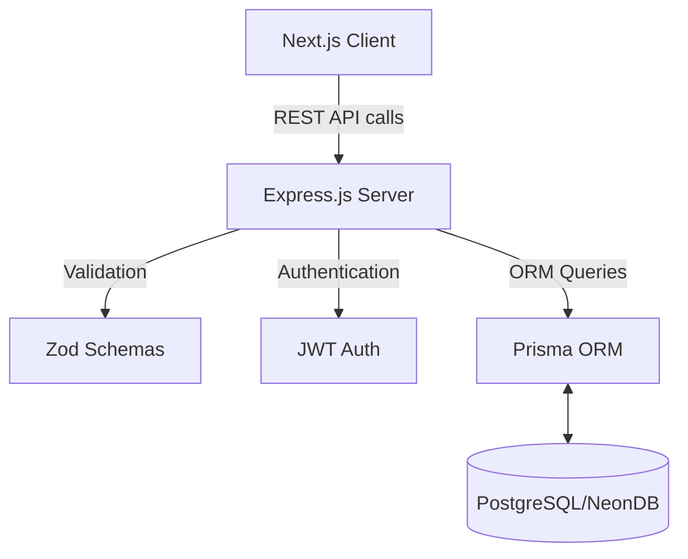

# Barruu 📚

An open, community-driven digital publishing platform for Afaan Oromo literature, creative writing, poetry, folk tales, and audio stories. Designed with a clean, distraction-free layout (inspired by DEV.to), it serves as a central hub for writers and readers to discover and share local storytelling.

---

## 📑 Table of Contents

1. [System Architecture](#system-architecture)
2. [Tech Stack](#tech-stack)
3. [Project Directory Structure](#project-directory-structure)
   - [Client (Next.js)](#client-frontend)
   - [Server (Express.js)](#server-backend)
4. [Detailed Data Flow](#detailed-data-flow)
5. [Local Development Setup](#local-development-setup)

---

## 🏗 System Architecture

Siidaa Barruu is built on a modern decoupled architecture. The frontend (Next.js) communicates with the backend (Express.js) through a RESTful API. The backend manages business logic and handles persistent data storage via Prisma ORM connected to a PostgreSQL database.



---

## 💻 Tech Stack

### Frontend (Client)
- **Framework**: Next.js 14+ (App Router)
- **Language**: TypeScript
- **Styling**: Tailwind CSS
- **State Management**: Zustand (Auth State)
- **Data Fetching**: TanStack React Query (Caching, Mutating, Fetching)
- **Rich Text Editor**: TipTap
- **Icons**: Lucide React

### Backend (Server)
- **Framework**: Node.js & Express.js
- **Language**: TypeScript
- **Architecture Pattern**: MVC (Controllers, Services, Validations, Routes)
- **ORM**: Prisma
- **Database**: PostgreSQL
- **Security**: bcryptjs (Hashing), jsonwebtoken (JWT Auth)
- **Validation**: Zod

---

## 📂 Project Directory Structure

The repository is organized into a mono-repo style structure containing both the `client` and `server`.

### Client (Frontend)

Located in `/client`.

| Directory / File | Purpose |
|------------------|---------|
| `src/app/` | Next.js App Router files. Contains main pages (`page.tsx`, `layout.tsx`). |
| `src/app/[category]/` | Dynamic route for filtering articles by category (e.g., Walaloo, Durdurii). |
| `src/app/barbaadi/` | Search results page. |
| `src/app/barreessi/` | The TipTap rich text editor page for creating/editing posts. |
| `src/app/barruu/[slug]/` | The article detail reading view. |
| `src/app/fayyadamaa/[username]/` | Public user profiles showing authored articles and stats. |
| `src/app/galmaai/` & `seeni/` | Registration and Login pages. |
| `src/components/` | Reusable UI components (`Header`, `ArticleCard`, `LeftSidebar`, `RightSidebar`). |
| `src/hooks/` | React Query custom hooks (`useArticles`, `useUsers`) abstracting all API calls. |
| `src/lib/` | Core configurations. Contains `api.ts` (Axios setup with JWT interceptors). |
| `src/store/` | Zustand state managers (e.g., `authStore.ts` for managing logged-in user state). |
| `src/types/` | Global TypeScript interfaces and utility functions (e.g., date formatting). |

### Server (Backend)

Located in `/server`.

| Directory / File | Purpose |
|------------------|---------|
| `src/index.ts` | The main Express application entry point. Configures middleware and maps routers. |
| `src/routes/` | Defines API endpoints. Maps URLs to their respective controllers (`articles.ts`, `auth.ts`). |
| `src/controllers/`| Orchestrates the request flow. Validates req body, calls services, and sends JSON res. |
| `src/services/` | Contains the core business logic. Interacts directly with the database. |
| `src/validations/`| Zod schemas ensuring incoming data from the client is structurally correct and safe. |
| `src/middleware/` | Express middlewares. E.g., `auth.ts` verifies JWT tokens to protect private routes. |
| `src/lib/` | Core utilities. Contains `prisma.ts` which exports the singleton Prisma Client. |
| `prisma/schema.prisma`| The single source of truth for the Database structure. Defines models and enums. |

---

## 🔄 Detailed Data Flow

Let's take **"Creating a new Article"** as an example of how the layers interact:

1. **User Action (Client)**: The user writes an article in the TipTap editor (`/barreessi/page.tsx`) and clicks "Publish".
2. **State & API Call (Client)**: The `useArticles` mutation hook is triggered. It uses the configured Axios client (`lib/api.ts`) which automatically attaches the user's JWT token to the `Authorization` header.
3. **Routing (Server)**: The request hits `POST /api/articles` defined in `routes/articles.ts`.
4. **Middleware (Server)**: The `authenticate` middleware in `middleware/auth.ts` intercepts the request, decodes the JWT, and attaches the `user.id` to the request object.
5. **Controller (Server)**: The request moves to `ArticleController.createArticle`. It runs the request body against the Zod `createArticleSchema`.
6. **Service (Server)**: If valid, the data is passed to `ArticleService.createArticle`. The service generates a unique URL slug, calculates reading time, and interacts with Prisma to save the post to PostgreSQL.
7. **Response**: The newly created article is returned as JSON to the client, triggering a success toast, invalidating the React Query cache, and redirecting the user to their new article.

---

## 🚀 Local Development Setup

Follow these instructions to run both environments locally.

### 1. Database Setup
1. Create a PostgreSQL database (locally or via a service like Neon).
2. Inside `/server`, copy the example env file:
   ```bash
   cp .env.example .env
   ```
3. Update the `DATABASE_URL` in `/server/.env` with your actual connection string.

### 2. Running the Server (Backend)
1. Navigate to the server folder:
   ```bash
   cd server
   ```
2. Install dependencies:
   ```bash
   npm install
   ```
3. Run Prisma Migrations to generate the tables in your database:
   ```bash
   npx prisma migrate dev --name init
   ```
4. Start the development server:
   ```bash
   npm run dev
   ```
   *The API will run on `http://localhost:5000`.*

### 3. Running the Client (Frontend)
1. Navigate to the client folder:
   ```bash
   cd client
   ```
2. Ensure you have the `.env.local` file pointing to your server:
   ```bash
   NEXT_PUBLIC_API_URL=http://localhost:5000/api
   ```
3. Install dependencies:
   ```bash
   npm install
   ```
4. Start the development server:
   ```bash
   npm run dev
   ```
   *The Web App will run on `http://localhost:3000`.*
